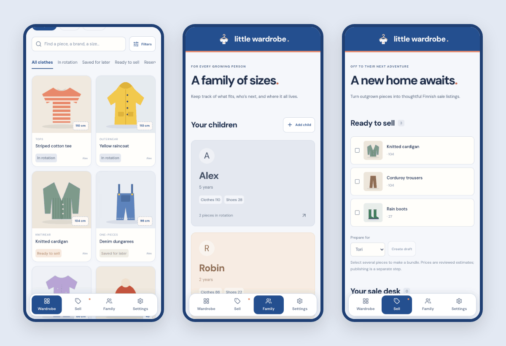
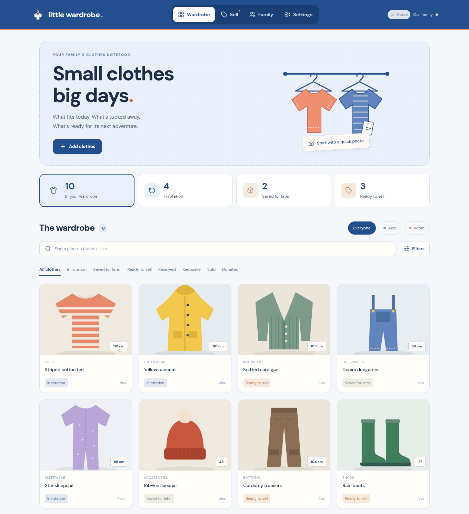

<p align="center">
  
</p>

<h1 align="center">Little Wardrobe</h1>

A shared notebook for a family's kids' clothes: what each child wears now, what's packed away for a younger sibling, and what's ready to sell. It's self-hosted and meant for the parents of one household, each on their own phone.

<p align="center">
  
</p>



_Screenshots use a throwaway household with illustrated mock clothes._

## What it does

Take a photo of a piece of clothing and, optionally, its size tag. If you've connected an AI provider, it suggests the name, category, size, colour, material, season and condition, and shows which fields it wasn't sure about. Nothing is saved until you've looked it over. Quick add lets you photograph a pile of clothes in a row and review them later while the server works through them.

Each piece belongs to a child and has a status: in rotation, saved for later, ready to sell, reserved, sold, donated or kept. You can mark who it should go to next, note where it's stored (the attic box, under the bed), and record purchase details, defects and private notes. Children have a birthday and current clothing and shoe sizes, and the app points out stored pieces that might fit now. Search and filters cover child, status, category, size, season and location.

The sell tab turns one piece or a bundle into a Finnish listing for Tori or Vinted, written by the AI or by hand. You set the price (AI prices are labelled as rough estimates), approve the draft, then copy the text and download or share the photos to post it yourself. The app doesn't post to marketplaces; [docs/MARKETPLACES.md](docs/MARKETPLACES.md) explains why. Vinted exports only ever use the original photos, never AI-edited ones. When something sells, other listings that include it are flagged for removal.

Both parents see changes live, and the app keeps working offline as an installed PWA, syncing queued edits when the connection comes back. The interface is in English.

## Running it locally

You need Nix with flakes. The dev shell has Node, Rust, Python and Chromium.

```sh
nix develop
npm ci
npm run dev
# in a second `nix develop` shell
cargo run --manifest-path backend/Cargo.toml
```

Open http://localhost:3101 (the backend listens on 127.0.0.1:3002). The first start writes a setup token to `data/setup-token`; use it to create the first account, then invite the other parent from Settings. The wardrobe starts empty.

AI is optional. In Settings you can point it at any OpenAI-compatible endpoint with a vision model, or pair a personal Hermes companion. An image model with `/images/edits` support enables optional background clean-ups of photos. See [docs/AI.md](docs/AI.md).

## Configuration

- `LITTLEWARDROBE_ORIGIN`: the exact URL people open, e.g. `https://wardrobe.example.com`.
- `LITTLEWARDROBE_DATA_DIR`: where the SQLite database and photos are stored (`/data` in the container).
- `LITTLEWARDROBE_SETUP_TOKEN` and `LITTLEWARDROBE_SECRET_KEY`: the first-owner token and the 64-character hex key that encrypts the AI credentials. Both are generated on first start if unset; keep the key.
- `LITTLEWARDROBE_SQLITE_JOURNAL_MODE=DELETE` if the data lives on NFS.
- `LITTLEWARDROBE_OIDC_*` for optional passkey sign-in through an OpenID Connect provider.

[docs/DEPLOYMENT.md](docs/DEPLOYMENT.md) has the full list.

## Deploying

CI publishes `ghcr.io/fruitiex/littlewardrobe:main`. It's a single non-root container serving the app and API on port 8080. Mount persistent storage at `/data`, run one replica, and put it behind your own HTTPS reverse proxy with `LITTLEWARDROBE_ORIGIN` set to match. HTTPS is needed for the camera, clipboard and installing the PWA. It holds photos of your children's clothes, so I'd keep it on a private network or VPN.

To build the image yourself:

```sh
nix build .#container --out-link result-container
docker load -i result-container
```

Example Kubernetes manifests (private gateway only) are in [deploy/kubernetes](deploy/kubernetes). Backups, restore and OIDC setup are covered in [docs/DEPLOYMENT.md](docs/DEPLOYMENT.md).

## Development

TanStack Start/Router, React, TypeScript and Tailwind on the frontend; Rust with Axum, Tokio and SQLite on the backend, with API types generated by ts-rs. The checks CI runs:

```sh
nix develop --command cargo fmt --manifest-path backend/Cargo.toml -- --check
nix develop --command cargo clippy --manifest-path backend/Cargo.toml --all-targets -- -D warnings
nix develop --command cargo test --manifest-path backend/Cargo.toml
nix develop --command npm run typecheck
nix develop --command npm test
nix develop --command npm run format:check
nix develop --command npm run build
nix develop --command npm run test:production
```

`test:production` runs the production build in headless Chromium against a temporary database and a fake AI provider, with a desktop and a phone session editing the same household. `npm run test:oidc` and `npm run test:container` cover passkey sign-in and the built image. [docs/PLAN.md](docs/PLAN.md) has the requirements and design notes.

## Credits

DM Sans and Fraunces are bundled under the SIL Open Font License (see `public/fonts/`). A Twemoji graphic used by an unused server feature is licensed CC BY 4.0, with the notice in `backend/assets/LICENSE-GRAPHICS.txt`. The app icon is `public/icon.svg`.

## License

MIT, see [LICENSE](LICENSE).
